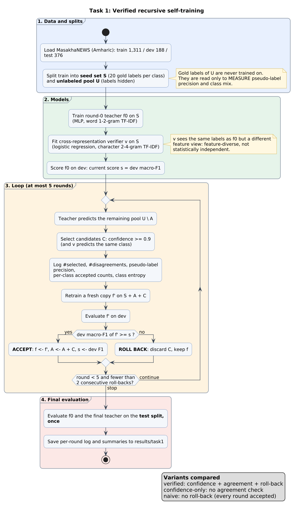
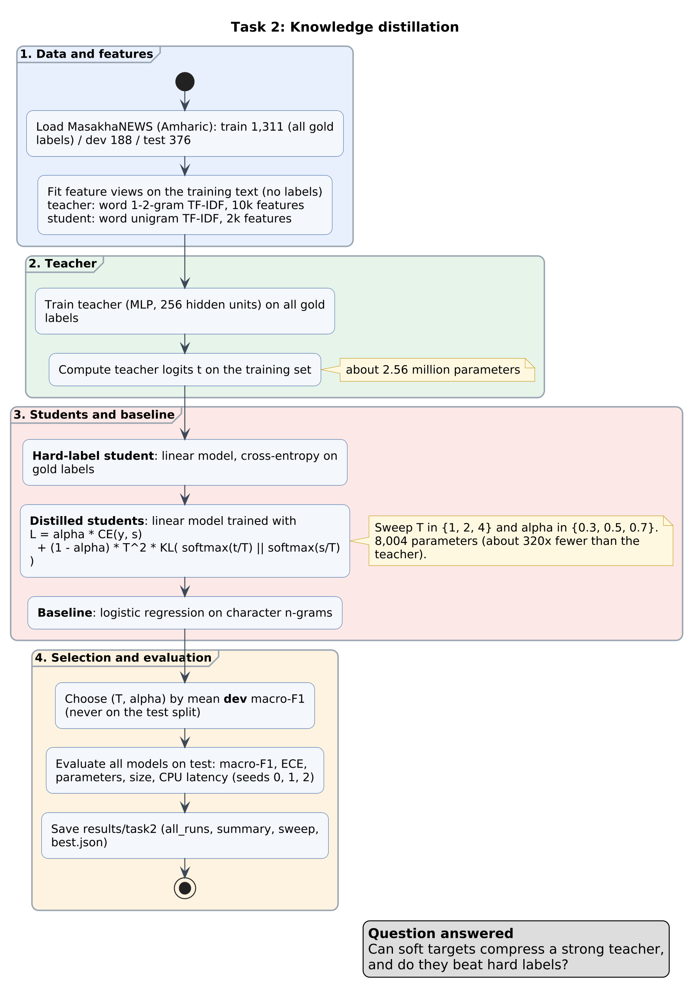
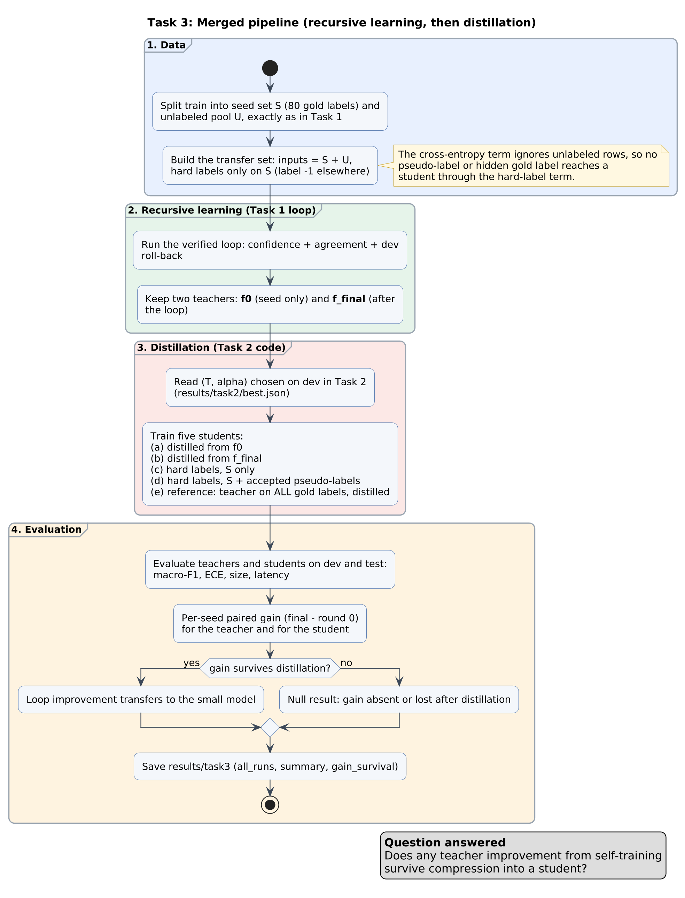

# Architecture of the three tasks

Each diagram is stored as PlantUML source (`*.puml`) and a rendered PNG (`img/`).
Render again with: `java -jar plantuml.jar -tpng -o img docs/*.puml`.

All three tasks share the same data protocol (`src/data.py`):

| Split | Size | Role |
|---|---|---|
| seed set S | 20 labelled articles per class (80) drawn from train | the only gold labels used in Tasks 1 and 3 |
| unlabeled pool U | rest of train (1,231) | labels hidden; gold labels read only to *measure* pseudo-label quality |
| dev | 188 | accept/rollback decisions and (T, alpha) selection |
| test | 376 | final reporting only |

## Task 1: verified recursive self-training

**What it does.** A teacher trained on the 80 seed labels pseudo-labels the pool. A verifier decides which pseudo-labels may enter the next training set. A fresh copy of the teacher is trained on seed + accepted pseudo-labels and replaces the current teacher only if development macro-F1 does not drop; otherwise the round is rolled back.

**Components (code).**
- Teacher: MLP on word 1-2-gram TF-IDF (`src/models.py`, `src/features.py`).
- Verifier: logistic regression on character 2-4-gram TF-IDF, fitted on the seed set only (`task1_recursive/verifier.py`). It is feature-diverse, not statistically independent of the teacher.
- Loop with rollback and per-round logging (`task1_recursive/selftrain.py`).

**Safeguards.** Gold labels of the pool are used only for monitoring; the test split is touched once at the end; every round logs the number of selected candidates, verifier disagreements, pseudo-label precision, per-class accepted counts and the entropy of the accepted-class distribution.

**Outputs.** `results/task1/` (per-round log, summary), run with `python -m task1_recursive.run`.

## Task 2: knowledge distillation

**What it does.** A strong teacher (trained on all 1,311 gold labels) is compressed into a linear student with about 320 times fewer parameters. A hard-label student and a character n-gram logistic regression serve as baselines. The distillation loss is
`alpha * CE(y, s) + (1 - alpha) * T^2 * KL(softmax(t/T) || softmax(s/T))`, swept over T in {1, 2, 4} and alpha in {0.3, 0.5, 0.7}; the pair is selected on development macro-F1.

**Outputs.** `results/task2/` including `best.json`, which Task 3 reads. Run with `python -m task2_distillation.run`.

## Task 3: merged pipeline

**What it does.** The Task 1 loop produces a round-0 teacher and a final teacher. Both are distilled with the Task 2 loss into the same student architecture on a transfer set made of seed + pool inputs. Hard labels exist only on the seed set (label -1 elsewhere), so no pseudo-label or hidden gold label reaches a student through the hard-label term. Reference students (hard labels on the seed set, hard labels on seed + accepted pseudo-labels, and a student distilled from a full-label teacher) frame the comparison.

**Key question.** Does any teacher improvement from self-training survive distillation? `results/task3/gain_survival.csv` reports the per-seed paired gain (final minus round 0) for teacher and student.

**Outputs.** `results/task3/`, run with `python -m task3_merged.run` after Task 2.

## Research extension (`research/`)
Added after peer review; it does not modify Tasks 1-3 (`research.loop` reproduces Task 1's verified variant exactly).
- `research/loop.py`: class-aware selection rules (`cap`, `balanced`), a char-LR teacher, temperature scaling, rollback margin, verifier-disagreement logging.
- `research/suite.py`: resumable experiment suites (10 seeds; label budgets; thresholds).
- `research/diagnostics.py`, `research/stats.py`, `research/distill_ext.py`, `research/latency_e2e.py`: diagnostics, paired statistics, non-linear student, end-to-end latency.
